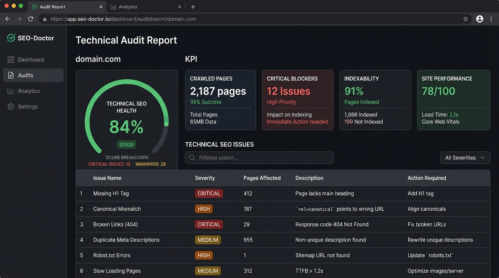

# SEO-Doctor 🩺

[](https://github.com/hamid-digitalmarketer/seo-doctor/actions/workflows/ci.yml)
[](https://www.python.org/downloads/)
[](LICENSE)
[](tests/)
[](https://github.com/astral-sh/ruff)
[](https://github.com/python/mypy)
[](#pricing--free-open-source)

A free, production-grade, open-source **technical SEO auditor, crawler, and site diagnostics engine**. Designed for business owners, SEO freelancers, marketing agencies, and web developers who need to identify indexing blockers, broken link equity, duplicate metadata, canonical tag conflicts, and crawl regressions—**without expensive monthly software subscriptions**.

---

## 📌 Executive Overview: Why Technical SEO Auditing Matters

Website owners frequently encounter discouraging organic search bottlenecks:
- *Why is my website not ranking on Google?*
- *Why are my newly published product pages not indexed?*
- *Which pages leak link equity through 404 dead ends or redirect chains?*
- *Did our recent staging deployment accidentally break canonical tags or introduce `noindex` directives?*

Most commercial tools (Screaming Frog, Ahrefs, Semrush) charge $120–$500/month or enforce strict URL caps. **SEO-Doctor** runs locally on your machine, respects target servers, detects technical search bottlenecks, prioritizes fixes into clear actionable tiers, and produces executive-ready **HTML, CSV, and JSON** audit reports.

---

## 📸 Interactive HTML Audit Dashboard

SEO-Doctor generates a standalone, responsive HTML report featuring a technical health score ring, critical blocker callouts, and filterable diagnostic tables:



---

## ⚡ Key Capabilities & Diagnostic Checks

SEO-Doctor audits your website across 10 specialized technical disciplines:

| Diagnostic Check | Issues Detected | Impact Level |
| :--- | :--- | :---: |
| **1. Broken Links** | Internal 404s, 500 server crashes, and broken external links | `CRITICAL` / `MEDIUM` |
| **2. Redirects** | Multi-hop redirect chains (2+ hops), redirect loops, temporary 302s | `CRITICAL` / `HIGH` |
| **3. Metadata** | Missing `<title>`, duplicate titles, short/long titles, missing/duplicate meta descriptions | `CRITICAL` / `HIGH` |
| **4. Headings** | Missing `<h1>`, multiple conflicting `<h1>` tags, skipped hierarchy levels (e.g. H1 $\to$ H3) | `HIGH` / `LOW` |
| **5. Canonical Tags** | Missing canonicals, multiple canonical tags, canonicals pointing to 404s or redirects | `CRITICAL` / `HIGH` |
| **6. Robots Directives** | Meta robots `noindex`/`nofollow`, `X-Robots-Tag` headers, and `robots.txt` disallows | `CRITICAL` / `HIGH` |
| **7. Images** | Missing `alt` attributes, empty `alt` on content images, broken image sources | `HIGH` / `MEDIUM` |
| **8. XML Sitemaps** | Missing `sitemap.xml`, dead 404 URLs in sitemap, sitemap URLs redirecting or noindexed | `CRITICAL` / `HIGH` |
| **9. Orphan Pages** | URLs discoverable in sitemaps that have 0 internal inbound links across the site | `HIGH` |
| **10. Indexability** | HTTP 4xx/5xx responses, thin body content (< 100 words), connection timeouts | `CRITICAL` / `LOW` |

---

## 🔄 Crawl Comparison (Tracking Regressions & Fixes)

SEO-Doctor includes built-in comparison to track changes between two crawl runs:

```bash
seo-doctor compare reports/run-2026-01-01.json reports/run-2026-02-01.json
```

**Terminal Comparison Output:**
```text
+--------------------------------------------------------------------+
| [?] Crawl Comparison Audit                                         |
| Baseline:   https://example.com (2026-01-01T12:00:00)              |
| Comparison: https://example.com (2026-02-01T12:00:00)              |
+--------------------------------------------------------------------+
               Score & Issue Delta
+-----------------------------------------------+
| Metric        | Baseline | Comparison | Delta |
|---------------+----------+------------+-------|
| Health Score  | 70       | 85         | +15   |
| Total Issues  | 14       | 6          | -8    |
| Pages Crawled | 120      | 124        | +4    |
+-----------------------------------------------+

[+] Issues Fixed (8):
  + https://example.com/checkout - broken_internal_link
  + https://example.com/pricing  - missing_canonical

[!] Issues Introduced (0):
  (No new technical regressions detected)
```

---

## 🚀 Installation & Quickstart

### Prerequisites
- Python 3.11+
- Git

### 1. Installation
```bash
git clone https://github.com/hamid-digitalmarketer/seo-doctor.git
cd seo-doctor
pip install -e .
```

### 2. Run Your First Crawl
```bash
# Audit any website up to 50 pages
seo-doctor crawl https://example.com --max-pages 50
```

### 3. Generated Report Artifacts
Each audit automatically exports three structured files into `./reports`:
- `reports/crawl-<timestamp>.html` — Interactive visual dashboard for clients & executives.
- `reports/crawl-<timestamp>.csv` — Spreadsheet for development ticket backlogs.
- `reports/crawl-<timestamp>.json` — Machine-readable dataset for automated diffs and CI/CD.

### 4. Launch Local Web Viewer
Browse and inspect historical reports directly in your browser:
```bash
seo-doctor serve --port 8000
```
Visit **[http://localhost:8000](http://localhost:8000)**.

---

## 🧪 Testing with the Included Sample Site

SEO-Doctor includes a pre-configured sample site with intentional SEO defects (`examples/sample-site`):

```bash
# 1. Start local mock site
python -m http.server 8000 --directory examples/sample-site

# 2. In another terminal, run audit against the sample site
seo-doctor crawl http://127.0.0.1:8000/index.html --sitemap http://127.0.0.1:8000/sitemap.xml
```

The audit will immediately detect:
- Broken internal links pointing to `/dead-single-origin-404.html`
- Multiple `<h1>` headings on `about.html`
- Duplicate title and meta description between `index.html` and `duplicate-meta-page.html`
- Orphan page candidate `orphan-page.html` listed in sitemap but having 0 inbound links
- Conflicting canonical tags and image tags missing `alt` attributes

---

## 🛡️ Security, Politeness & Ethical Guidelines

- **Configurable Rate Limiting**: Defaults to `--delay 0.05` seconds between requests to avoid overloading origin servers.
- **`robots.txt` Compliance**: Reads and enforces `robots.txt` disallow rules by default (`--respect-robots-txt`).
- **No Private Data Storage**: Does not store customer personal data, login credentials, or ad tokens.
- **Non-Aggressive Footprint**: User-Agent header is configurable (`--user-agent`).
- **Deterministic**: Does not require external LLM APIs for core auditing, guaranteeing zero cloud token costs and reproducible output.

---

## 📂 Repository Structure

```
seo-doctor/
├── .github/
│   ├── workflows/ci.yml             # GitHub Actions CI (Ruff, Mypy, Pytest)
│   ├── ISSUE_TEMPLATE/              # Standardized bug report & feature request templates
│   └── pull_request_template.md     # Pull request checklist
├── src/
│   └── seo_doctor/
│       ├── __init__.py              # Package version & top-level exports
│       ├── cli.py                   # Typer CLI application (crawl, compare, serve)
│       ├── config.py                # Crawl configuration & validation model
│       ├── crawler.py               # BFS crawler, robots.txt, sitemap XML parser
│       ├── models.py                # Pydantic schemas (SEOIssue, CrawledPage, Report)
│       ├── storage.py               # SQLite storage layer for crawl persistence
│       ├── report.py                # HTML, CSV, and JSON export generators
│       ├── compare.py               # Two-run crawl comparison and regression tracker
│       ├── checks/                  # 10 specialized technical SEO audit checks
│       │   ├── broken_links.py      # Internal & external dead link verification
│       │   ├── redirects.py         # Chains, loops, and temporary 302 flags
│       │   ├── metadata.py          # Title & description presence, length, duplicates
│       │   ├── headings.py          # H1 presence, multiple H1s, skipped levels
│       │   ├── canonical.py         # Missing canonicals, conflicts, 404 targets
│       │   ├── robots.py            # Meta noindex/nofollow, X-Robots-Tag, robots.txt
│       │   ├── images.py            # Missing & empty alt attributes, broken images
│       │   ├── sitemap.py           # Sitemap discovery, broken/redirected sitemap URLs
│       │   ├── orphan_pages.py      # Inbound link graph orphan page candidate detection
│       │   └── indexability.py      # HTTP status synthesis & thin content detection
│       └── templates/
│           └── report.html          # Responsive Tailwind CSS dashboard template
├── tests/
│   ├── fixtures/sample_pages.py     # Isolated HTML test fixtures (no live web calls)
│   ├── test_crawler.py              # URL normalization, sitemaps, robots.txt tests
│   ├── test_checks.py               # Unit tests covering all 10 diagnostic checks
│   ├── test_report.py               # JSON, CSV, and HTML export verification
│   ├── test_compare.py              # Crawl comparison and delta logic tests
│   └── test_cli.py                  # CLI command runner tests
├── examples/
│   └── sample-site/                 # Realistic site with intentional SEO defects
├── docs/
│   ├── market-research.md           # Industry pain points & competitive analysis
│   ├── limitations.md               # Technical boundaries & non-goals
│   └── usage.md                     # CLI recipes, local staging & CI/CD guide
├── reports/                         # Default directory for audit reports (.gitkeep)
├── pyproject.toml                   # Project metadata, dependencies & tool configs
├── CONTRIBUTING.md                  # Developer contribution guide
├── LICENSE                          # MIT License
└── README.md                        # Master documentation
```

---

## 🗺️ Product Roadmap

- [x] Internal BFS crawler with depth limits and polite rate-limiting.
- [x] 10 core technical SEO checks (broken links, redirects, metadata, headings, canonicals, robots, images, sitemaps, orphans, indexability).
- [x] Multi-format exports: HTML visual dashboard, CSV backlog, JSON dataset.
- [x] Crawl comparison engine (`seo-doctor compare`).
- [x] Local SQLite persistence and FastAPI web viewer (`seo-doctor serve`).
- [ ] Core Web Vitals (LCP, CLS, FID) integration via Chrome Performance API.
- [ ] Internationalization (hreflang) tag validation across multi-lingual paths.
- [ ] Automated Google Search Console URL Inspection API sync.

---

## 📄 License

This project is licensed under the **MIT License** — see the [LICENSE](LICENSE) file for details.
